# WPC Sound Editor

*[English](#english) · [Castellano](#castellano)*

---

## English

A local editor for the **sound ROMs of Williams / Bally WPC pinball machines**. Load your
own ROM dumps, hear every sound, replace voices, effects and music with your own audio,
and download patched images ready for PinMAME or for burning into EPROMs.

It is the first piece of a larger project: an IDE / SDK for programming and patching real
WPC machines on top of FreeWPC.

### What it does

**Pre-DCS boards** (1990–1993: YM2151 FM + HC55516 CVSD + 8-bit DAC) — pilot: *Twilight Zone*

- Reads the ROM set's own sample directory: every DAC and CVSD block, exactly, drawn on
  the chips as they really are.
- Plays any block; replaces it with a WAV (trim, loop, speed or automatic fit); hears the
  result encoded and decoded again, as the board would play it.
- Emulates the sound board (its own MC6809 core) to render the **FM music**, which is not
  audio but a stream of YM2151 register writes; exports it to MIDI.
- Replaces a music cue with a recording (DAC or CVSD), or **compiles a MIDI file into the
  game's own FM music**, with a choice among the game's 104 instruments.
- Fixes the sound board's power-on checksum on every exported image.

**DCS boards** (1993–1998) — pilot: *Star Trek: The Next Generation*

- Lists every track (the 482 of STTNG) by channel, drawn on the seven ROM chips.
- Replaces a track with any audio the browser can decode: a waveform trimmer with a
  slot-sized window, speed fitting that keeps the pitch, and "hear it in the ROM" that
  encodes and decodes for real.
- Picks the best quality that still fits the original chips, so the set stays drop-in.

Verified in PinMAME: patched sets boot like the originals and play the new audio.

### Screenshots

| | |
| --- | --- |
| 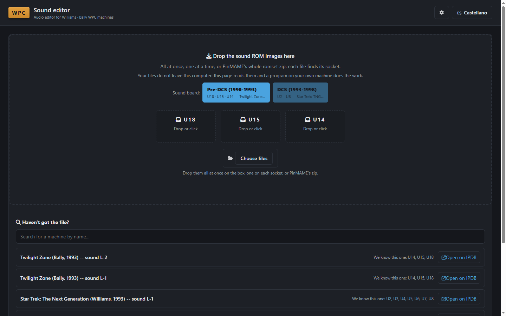 | 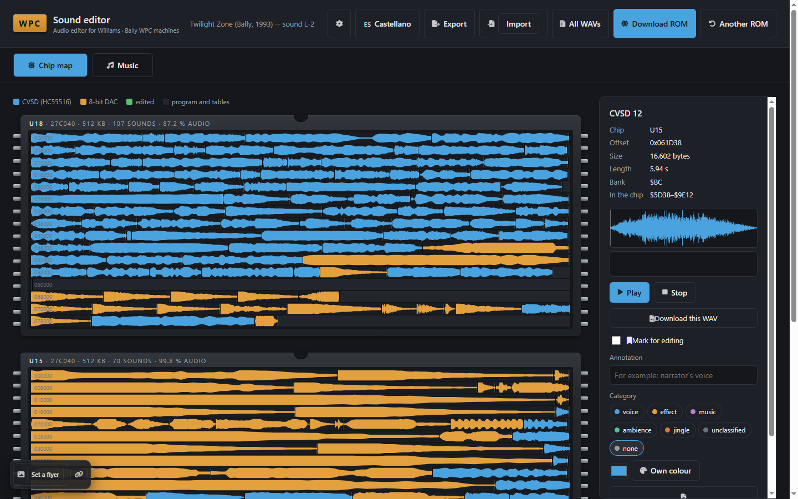 |
| **Loading** — pick the board, drop the files or PinMAME's zip | **Twilight Zone** — every sound block in place on its chip |
| 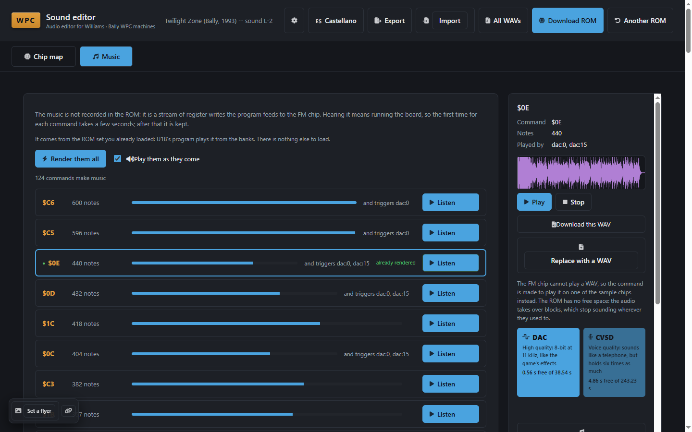 | 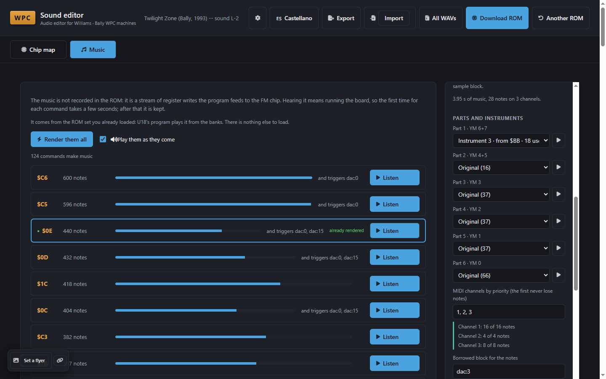 |
| **Music** — the FM music rendered by emulating the board | **MIDI** — parts, instruments and channel priority |
| 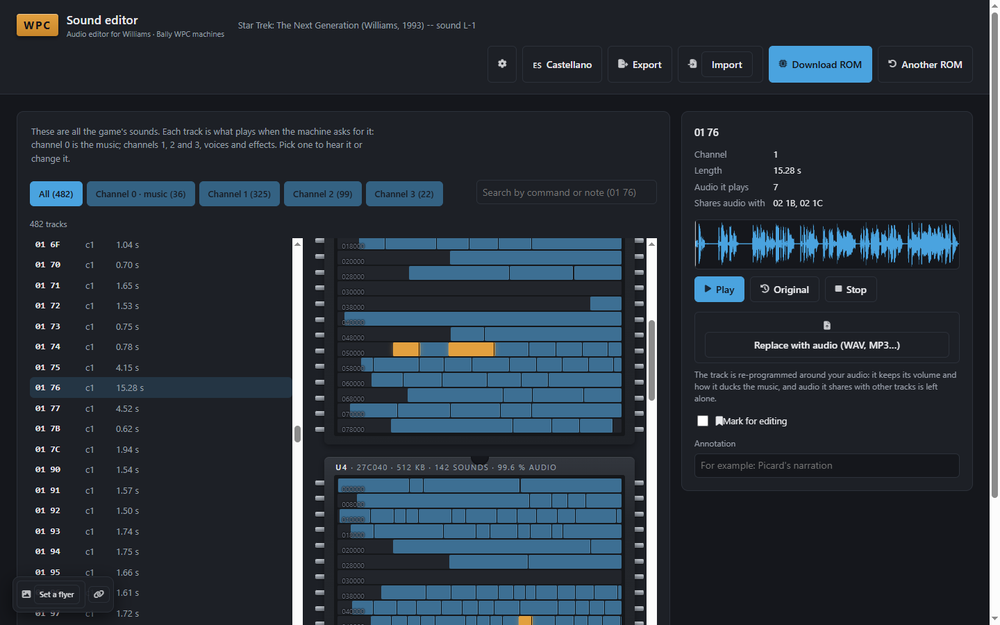 | 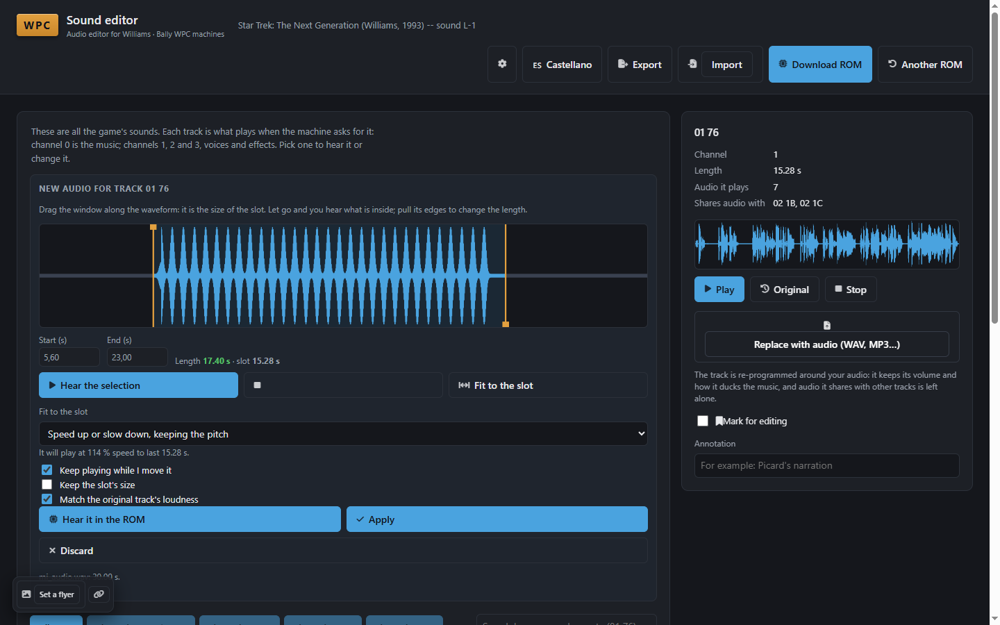 |
| **STTNG (DCS)** — 482 tracks, their audio lit on the 7 ROMs | **Trimmer** — a slot-sized window and speed fitting |

### ROMs

**No ROM images are distributed here, and none ever will be.** Each user supplies their
own dumps. The editor identifies a set by the CRC32 of every chip (that is also the import
check), works on it locally, and never uploads anything. Official images are published on
the IPDB machine pages with Planetary Pinball Supply's permission; the editor can open
those pages in your browser, but downloading is up to you.

### Running it

Requirements: Windows, Python 3 (developed and tested on 3.15) and `numpy` (`pip install -r requirements.txt`).

```
python -m wpcide            # opens http://127.0.0.1:8765/ in your browser
```

Some features use external programs that you download yourself — see
[tools/README.md](tools/README.md): VGMPlay (FM music), DCS Explorer / DCS Encoder (DCS
games) and PinMAME (testing).

A Windows package can be built with `python -m PyInstaller EditorWPC.spec --noconfirm`;
run **`dist\EditorWPC\EditorWPC.exe`** (not the copy under `build\`).

Tests: `python -m pytest tests -q`.

User manual: **[docs/manual.en.md](docs/manual.en.md)**.

### Project layout

| Folder | What |
| --- | --- |
| `wpcaudio/` | Codecs (HC55516, DAC), sample directory, board emulation, music, MIDI, DCS |
| `wpc6809/` | MC6809 disassembler and CPU emulator |
| `wpcide/` | The editor: local server and web page |
| `scripts/` | Command-line tools (extract, replace, map, trace, compile MIDI…) |
| `mapas/` | Sound maps and instrument catalogue built from the games |
| `tests/` | Test suite (synthetic data; no ROMs needed) |
| `docs/` | User manual |

---

## Castellano

Un editor local para las **ROM de sonido de las máquinas de pinball Williams / Bally WPC**.
Cargas tus propios volcados, escuchas cada sonido, sustituyes voces, efectos y música por
tu propio audio, y descargas las imágenes parcheadas, listas para PinMAME o para grabar en
EPROM.

Es la primera pieza de un proyecto mayor: un IDE / SDK para programar y parchear máquinas
WPC reales sobre FreeWPC.

### Qué hace

**Placas anteriores a DCS** (1990–1993: YM2151 FM + HC55516 CVSD + DAC de 8 bits) — piloto:
*Twilight Zone*

- Lee el propio directorio de muestras de la ROM: todos los bloques DAC y CVSD, exactos,
  dibujados en los chips tal como están.
- Reproduce cualquier bloque; lo sustituye por un WAV (recorte, bucle, velocidad o ajuste
  automático) y deja oír el resultado codificado y decodificado, como lo tocaría la placa.
- Emula la placa de sonido (con su propio núcleo MC6809) para renderizar la **música FM**,
  que no es audio sino escrituras en los registros del YM2151; la exporta a MIDI.
- Sustituye una música por una grabación (DAC o CVSD), o **compila un MIDI a la propia
  música FM del juego**, eligiendo entre sus 104 instrumentos.
- Corrige el checksum de arranque de la placa de sonido en cada imagen exportada.

**Placas DCS** (1993–1998) — piloto: *Star Trek: The Next Generation*

- Lista todas las pistas (las 482 de STTNG) por canal, dibujadas en los siete chips.
- Sustituye una pista por cualquier audio que el navegador sepa leer: recortador sobre la
  onda con una ventana del tamaño del hueco, ajuste de velocidad conservando el tono y
  "escuchar en la ROM", que codifica y decodifica de verdad.
- Elige la mejor calidad que cabe en los chips originales, para que el juego siga siendo
  un recambio directo.

Verificado en PinMAME: los juegos parcheados arrancan como los originales y suenan con el
audio nuevo.

### Capturas

| | |
| --- | --- |
| 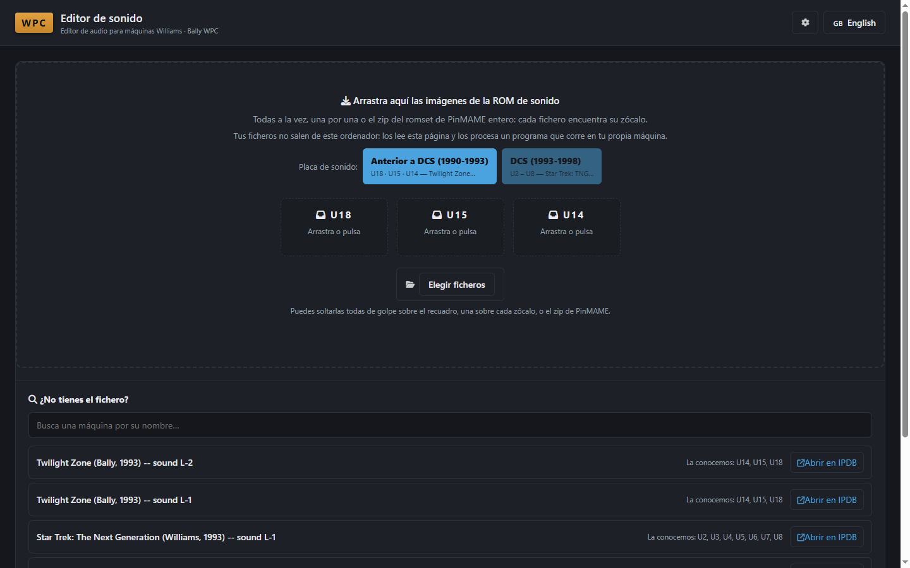 | 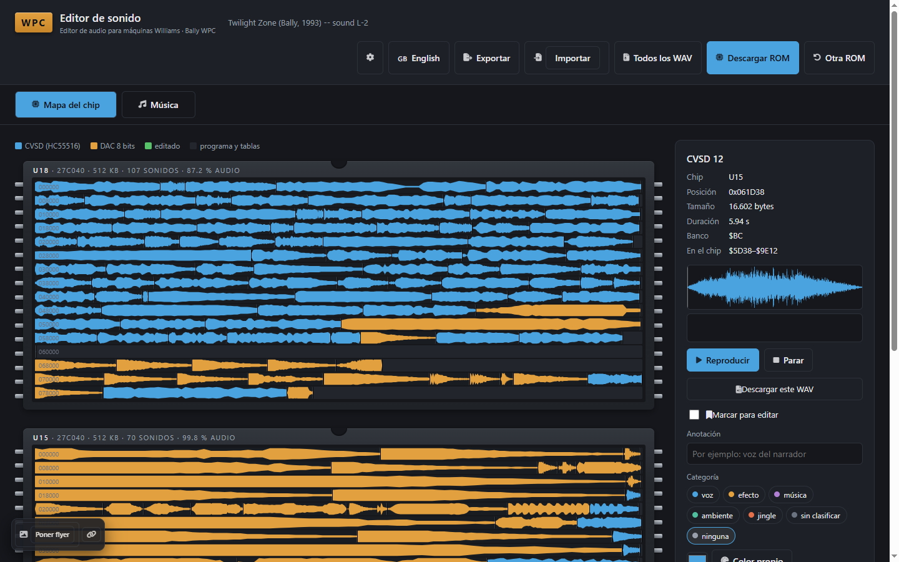 |
| **Carga** — eliges la placa y sueltas los ficheros o el zip de PinMAME | **Twilight Zone** — cada bloque de sonido en su sitio del chip |
| 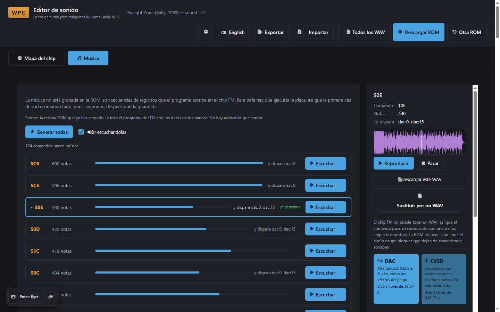 | 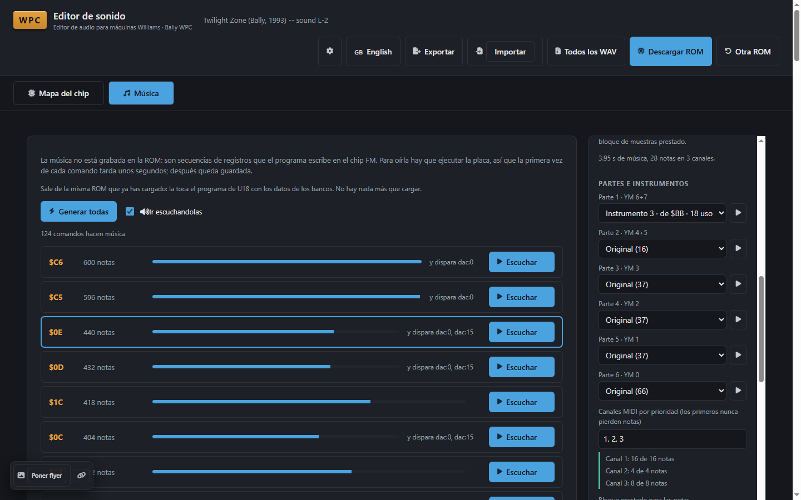 |
| **Música** — la música FM, generada emulando la placa | **MIDI** — partes, instrumentos y prioridad de canales |
| 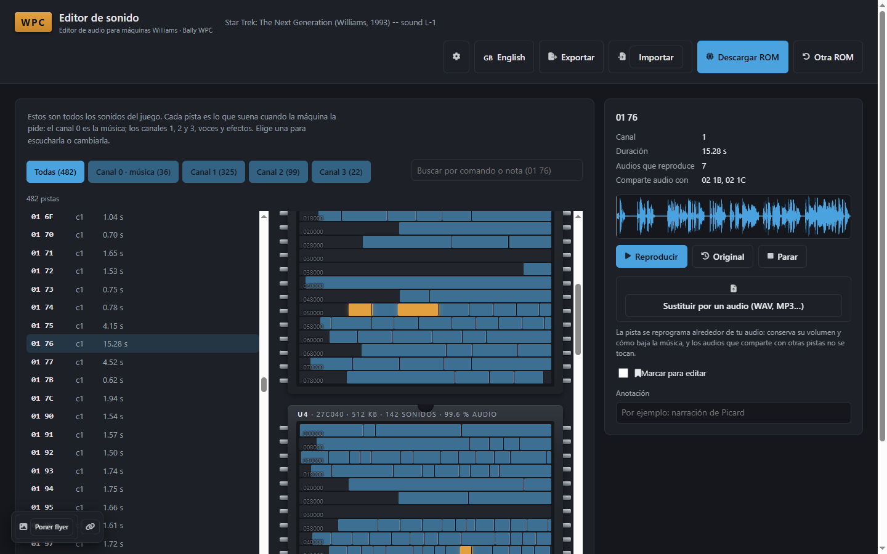 | 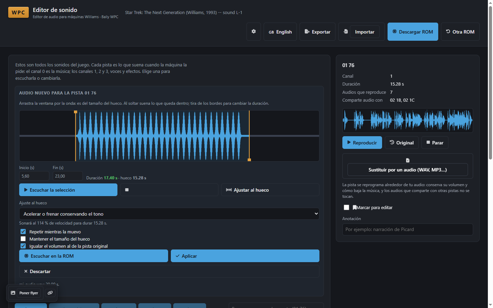 |
| **STTNG (DCS)** — 482 pistas y su audio iluminado en las 7 ROM | **Recortador** — ventana del tamaño del hueco y ajuste de velocidad |

### ROMs

**Aquí no se distribuye ninguna imagen de ROM, ni se distribuirá nunca.** Cada usuario
aporta sus volcados. El editor identifica el juego por el CRC32 de cada chip (que es
también la comprobación al importar), trabaja en local y no sube nada. Las imágenes
oficiales están publicadas en las fichas de IPDB con permiso de Planetary Pinball Supply;
el editor puede abrirte esas fichas en el navegador, pero la descarga la haces tú.

### Cómo se usa

Necesitas Windows, Python 3 (desarrollado y probado con la 3.15) y `numpy` (`pip install -r requirements.txt`).

```
python -m wpcide            # abre http://127.0.0.1:8765/ en el navegador
```

Algunas funciones usan programas externos que descargas tú — ver
[tools/README.md](tools/README.md): VGMPlay (música FM), DCS Explorer / DCS Encoder (juegos
DCS) y PinMAME (pruebas).

Para crear el paquete de Windows: `python -m PyInstaller EditorWPC.spec --noconfirm`, y se
abre **`dist\EditorWPC\EditorWPC.exe`** (no la copia de `build\`).

Tests: `python -m pytest tests -q`.

Manual de usuario: **[docs/manual.es.md](docs/manual.es.md)**.

---

## Credits / Créditos

This project stands on other people's work. / Este proyecto se apoya en el trabajo de otros.

| Who / Quién | What we used / Qué usamos | Licence / Licencia |
| --- | --- | --- |
| **The MAME and PinMAME teams** | PinMAME, to run and verify patched sets; its sources (`hc55516.c`, `wmssnd.c`, `ym2151.c`, the WPC drivers) as the hardware documentation behind the HC55516 codec constants, the sound board banking and the YM2151 delayed IRQ clear | BSD-3-Clause / old MAME licence |
| **Michael J Roberts** | **DCS Explorer** and **DCS Encoder**, which decode and rebuild DCS sound ROMs, and his *DCS Audio Format Technical Reference* | BSD-3-Clause |
| ↳ used by DCS Explorer | ADSP-21xx emulator by Aaron Giles (via PinMAME), libnyquist (Dimitri Diakopoulos), libsamplerate (Erik de Castro Lopo), miniz (RAD Game Tools, Valve, Rich Geldreich) | BSD / BSD / BSD / MIT |
| **Valley Bell** and contributors (vgmrips) | **VGMPlay**, which synthesises the YM2151 music from VGM logs (its cores are largely MAME's) | see VGMPlay's own documentation |
| **Fonticons, Inc.** | **Font Awesome Free 6.7.2** icons and fonts | Icons CC BY 4.0, fonts SIL OFL 1.1, code MIT |
| **NumPy developers** | NumPy | BSD-3-Clause |
| **The Python Software Foundation** | Python and its standard library | PSF License |
| **PyInstaller developers** | Packaging the Windows executable | GPL-2.0 with bootloader exception |
| **Igor Pavlov** | 7-Zip, to unpack the legacy *imploded* IPDB archives | LGPL |
| **IPDB — The Internet Pinball Database** | Machine pages and official ROM images | — |
| **Planetary Pinball Supply** | Permission for the Williams/Bally ROM images IPDB publishes | — |
| **FreeWPC** (Brian Dominy and contributors) | The open WPC platform this IDE is built to target | GPL |
| **The VGM format** (vgmrips) | The register-log format the music is exported to | — |


## Trademarks / Marcas

Williams®, Bally® and the machine names are trademarks of their respective owners. This is
an independent project with no relationship to or endorsement from them, and it uses the
names only to describe compatibility. / Williams®, Bally® y los nombres de las máquinas son
marcas de sus titulares. Este es un proyecto independiente, sin relación ni respaldo por su
parte, que usa los nombres solo para indicar compatibilidad.

## Licence / Licencia

MIT — see [LICENSE](LICENSE). It covers this repository's code only; every third-party
program keeps its own licence. / MIT — ver [LICENSE](LICENSE). Cubre solo el código de
este repositorio; cada programa de terceros conserva la suya.
